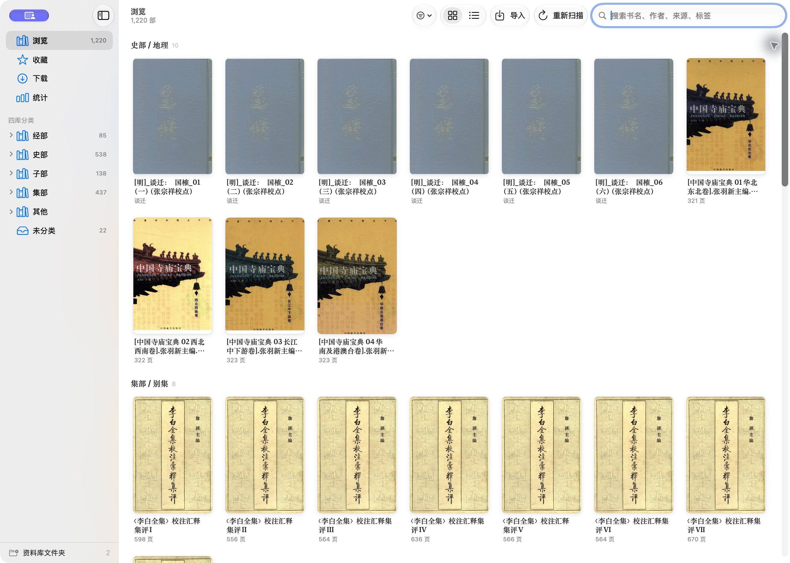
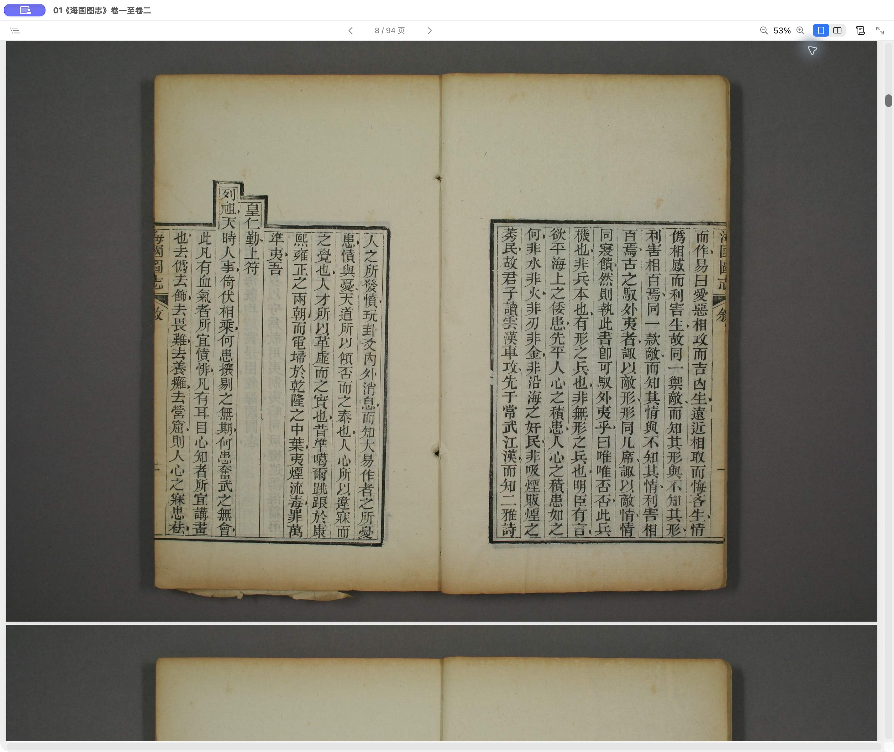
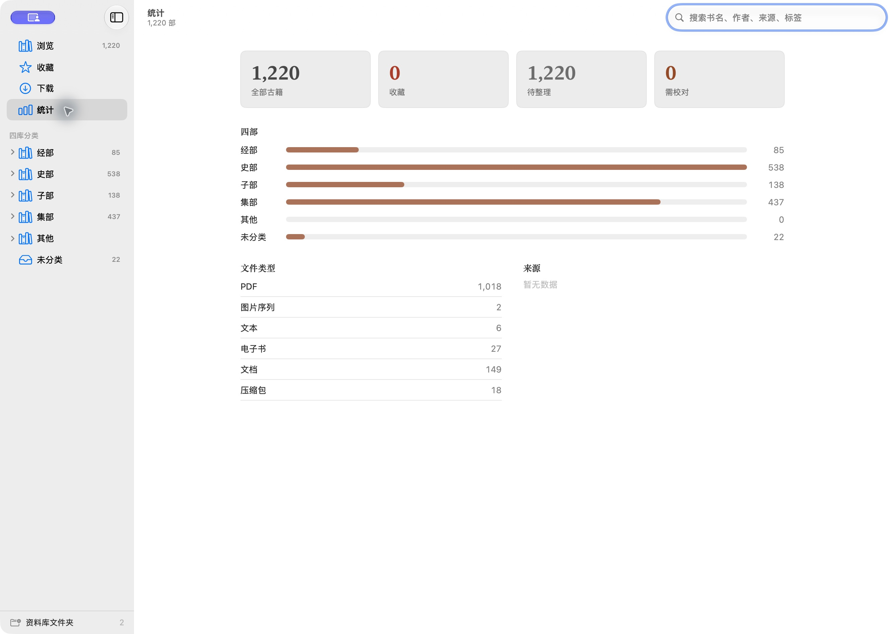

# 木天

木天是一个本地优先的 macOS 古籍资料库应用，用于整理、收藏、检索、下载、统计和阅读本地古籍资料。项目包名与 GitHub 仓库名为 `MuTian`。

[下载 v1.0](https://github.com/aihaogu/MuTian/releases/tag/v1.0) · [版本说明](docs/releases/v1.0.md) · [反馈问题](https://github.com/aihaogu/MuTian/issues)


## 软件截图

### 资料库浏览

按四库分类浏览古籍，支持封面网格、列表、搜索和筛选。



### 独立阅读窗口

将书籍单独打开，使用页码导航、缩放和页面布局工具阅读古籍影像。



### 资料库统计

查看书目总量、收藏、整理状态、四部分类及文件类型分布。



截图为实际应用界面；书目、封面和页数来自本机资料库，不随安装包提供，也不代表容量上限。外观会随 macOS 版本有所差异。

## 安装

- **系统**：macOS 14 或更新版本。
- **v1.0 安装包**：Apple Silicon（M 系列芯片），`MuTian-v1.0-macOS-arm64.zip`。本次未提供 Intel 安装包。
- **依赖**：应用已内置下载引擎、Python 运行环境与 HTTPS 根证书，使用者无需安装 Python 或 Go。

1. 前往 [v1.0 Release](https://github.com/aihaogu/MuTian/releases/tag/v1.0)，在 Assets 中下载上述 ZIP。GitHub 自动生成的 Source code 是源码，不是应用安装包。
2. 解压，将 `木天.app` 拖入“应用程序”文件夹。
3. 启动木天，按下文导入自己的古籍目录。

v1.0 使用临时签名，尚未进行 Developer ID 签名及 Apple 公证。首次启动若被拦截，确认下载来源与校验值后，可按系统提示在“系统设置 → 隐私与安全性”中选择“仍要打开”。详见 [Apple 的打开 App 说明](https://support.apple.com/zh-cn/102445)。

需要校验下载文件时，将 ZIP 与 `SHA256SUMS.txt` 放在同一文件夹，在该目录执行：

```sh
shasum -a 256 -c SHA256SUMS.txt
```

升级前先正常退出旧版，并备份下文列出的应用数据目录和实际古籍文件目录；然后替换“应用程序”里的旧版 App。

## 使用说明

### 1. 导入本地古籍

1. 在“浏览”页点击工具栏“导入”，或按 `⌘I`。
2. 选择古籍文件夹或支持的文件。图片序列应放在同一本书的文件夹中，并使用可自然排序的文件名，如 `001.jpg`、`002.jpg`。
3. 等待扫描完成，书目会出现在资料库中。导入建立本地索引，原文件仍保留在原目录。
4. 文件新增或变动后点击“重新扫描”（`⌘R`）。通过侧栏底部“资料库文件夹”（`⇧⌘L`）可以添加位置、单独重扫或移除位置；移除资料库位置不会删除磁盘原文件。

### 2. 整理、搜索与收藏

- 点击封面或列表中的书目，切换到详情区的“书目”页，编辑书名、作者、朝代、版本、来源、四库分类、标签及整理状态。
- 点击星形按钮收藏；侧栏“收藏”集中显示已收藏书目。
- 顶部搜索框支持书名、作者、朝代、版本、来源、路径、书目备注及标签的文本匹配；当前尚未提供书籍全文/OCR 索引。
- 点击侧栏分类，或使用工具栏筛选菜单按来源、整理状态缩小范围。封面/列表切换按钮用于调整浏览方式。
- “统计”页用于查看当前资料库的分类、类型和整理情况。

### 3. 阅读

- 选择书目后可在详情区阅读；点击“阅读”按钮，或右键书目选择“在新窗口中阅读”，打开独立窗口。独立窗口可进入或退出全屏。
- **PDF / 图片序列**：支持上一页/下一页、单页/双页、连续滚动/分页、从右向左排列、封面单独显示，以及适应窗口、适应宽度和固定比例缩放。
- **目录**：带目录的 PDF 和 EPUB 可展开目录跳转；图片序列提供页码列表。没有目录数据的 PDF 不会凭空生成章节目录。
- **文本 / EPUB**：可调整文字缩放；EPUB 支持层级目录与章节内锚点跳转。
- 阅读位置自动保存。文件被移走时，可使用阅读页的重新定位入口，或在目录恢复可读后重新扫描。
- Office 文档使用系统预览；其他格式的支持范围见“阅读格式”。

### 4. 下载并导入

1. 打开侧栏“下载”，粘贴支持的古籍页面、直接图片/PDF 链接或 IIIF manifest 链接。
2. 可先点击“先解析”检查信息，再选择输出目录并展开选项设置页码/册号范围、并发、重试等参数。
3. 点击“开始下载”。任务卡片显示状态、进度及操作；展开任务查看日志和错误。
4. 下载完成后，程序依据本次下载结果清单导入资料库。已导入任务可点击“查看书目”。
5. 失败任务可重试；只有通过来源与内容校验的已有文件会被跳过。删除任务不删除已经下载的文件。

当前 App 使用内置 **Python 下载引擎**。其站点支持范围与原 Go 版 bookget 并不完全一致；详细范围及参数限制见 [下载引擎说明](bookget_py/README.md)。

### 5. 常见问题

| 情况 | 处理方式 |
| --- | --- |
| 书目存在，但打不开原文件 | 检查磁盘/移动硬盘是否在线；重新定位书籍或重扫原目录。 |
| 提示资料库无法读取 | 暂停导入，使用侧栏“从备份恢复资料库”；不要直接覆盖 `library.json`。 |
| 网站链接无法解析或下载 | 查看任务错误日志，确认该站点已被 Python 引擎支持；登录、验证码及瓦片站点存在限制。 |
| 想阅读 DJVU、MOBI 等格式 | 可保留书目索引，使用外部兼容应用打开。 |
| 需要 OCR、自动校对或版本对读 | 这些功能仍属后续规划；现有页面数据字段不代表已实现识别与校勘。 |

## 当前功能

- 扫描并导入本地古籍文件夹、PDF、图片序列、文本、EPUB 和元数据文件。
- 在“资料库文件夹”窗口（侧栏底部，或菜单“资料库 > 管理资料库文件夹…”，⇧⌘L）查看资料库来自哪些位置，添加、单独重新扫描或移除位置。移除只把书目移出资料库，不删除磁盘文件，并在移除前备份索引。
- 以经、史、子、集为核心建立四库分类体系，侧边栏分类可以展开或收起。
- 浏览页按分类展示古籍，支持封面网格和列表两种视图，并按滚动进度增量加载，减少大资料库切换卡顿。
- 管理书名、作者、朝代、版本、来源、标签、收藏状态、整理状态和阅读进度。
- 按分类、来源、文件类型、整理状态和收藏状态统计本地资料库。
- 支持 PDF、图片序列、文本和 EPUB 阅读；EPUB 会解析目录章节，阅读器支持独立窗口与全屏、单双页、阅读方向和缩放设置。
- 支持收藏、Finder 定位、书目信息编辑和阅读进度保存。
- 在 macOS App 中创建下载任务，支持链接解析、输出目录选择、进度显示、日志查看、任务删除，并在下载完成后导入本地资料库。

## 阅读格式

- `PDF`：使用 macOS PDFKit 直接阅读，滚动和工具栏页码同步，切换书籍及全屏窗口保留各自阅读进度。
- `图片序列`：按自然排序作为页序阅读。
- `文本`：支持 UTF-8、带 BOM 的 UTF-16/UTF-32 和 GB18030 等常见编码。
- `EPUB`：按需解包并解析 OPF/NCX 目录，用内置 WebKit 阅读章节内容。
- `DOC/DOCX/PPT/PPTX`：使用 macOS 系统文档预览，具体显示能力取决于系统支持。

`DJVU/UVZ/MOBI/AZW3/ZIP` 可建立书目索引，目前需要使用外部兼容应用打开，尚未提供内置解码器。

## 下载功能来源

本项目的数字古籍下载功能来自 `bookget`。

`bookget` 原项目地址：

https://github.com/deweizhu/bookget

`bookget` 是一个数字古籍图书下载工具，支持多个数字图书馆、古籍平台和 IIIF 资源站点。木天在 macOS App 中负责下载任务配置、链接解析、进度展示、日志查看、结果导入和本地资料库管理。

## 开发

需要 Swift 6 工具链；CI 使用 Xcode 16.2。本地也可使用匹配 SDK 的较新 Xcode / Command Line Tools。

运行 macOS App：

```sh
./script/build_and_run.sh
```

只构建应用可运行 `./script/build_and_run.sh --build`。构建输出为 `dist/木天.app`，包含下载引擎、Python 运行环境和 HTTPS 根证书，可移出源码目录使用。首次打包会在项目的 `.build/bookget-packaging-venv/` 中安装固定版本的构建依赖，需要联网；可用 `MUTIAN_BUILD_PYTHON` 指定用于创建虚拟环境的 Python（3.10 或更新版本）。产物按当前构建机器的架构生成，使用本地临时签名。构建不会终止正在运行的木天；若应用已运行，保存并退出后再打开新版。

统一回归入口为 `./scripts/test_all.sh`，包含 Swift 构建、数据迁移、阅读解析、资料库及下载任务状态、Python 下载逻辑测试。单独检查可运行 `./scripts/test_app_paths.sh`、`./scripts/test_readers.sh` 或 `./scripts/test_stores.sh`（支持仅安装 Command Line Tools 的环境）。`./scripts/test_bundle.sh` 会将已构建应用复制到临时目录，在清空环境变量并限制 PATH 后验证下载引擎及离线下载。GitHub Actions 执行同一套检查。

阅读回归检查运行 `./scripts/test_readers.sh`，覆盖路径修复、书目与笔记保留、文本编码、EPUB 目录权限及注释兼容、同名文件缓存隔离。可额外传入 `library.json` 与现有资料目录，检查实际文件；所有测试解包输出位于临时目录。

发布包使用 Release 优化构建：

```sh
./scripts/package_release.sh
```

版本号由 `VERSION` 统一读取。该脚本生成 `dist/release/` 下的 ZIP、SHA-256 校验值和构建信息，并验证应用签名及迁移后的下载引擎。构建信息采集使用 `xcodebuild`，发布打包需要完整 Xcode。

维护者发布新版本时，同步 `VERSION`、应用构建号与 `docs/releases/<标签>.md`，提交后推送对应 `v*` 标签。`Publish release` 工作流会核对版本、运行回归、构建并验证安装包，全部成功后才创建 GitHub Release。当前自动发布目标为 Apple Silicon。

项目结构：

- `MuTian/`：macOS SwiftUI App 源码。
- `bookget/`：数字古籍下载引擎源码，来源于 `deweizhu/bookget`。
- `bookget_py/`：Python 版本下载能力实现，包含站点路由和国家图书馆下载支持。
- `scripts/`、`script/`：构建和运行脚本。

## 本地数据

应用数据存放在 `~/Library/Application Support/木天/`。首次运行会复制旧版“得古”的资料库、设置和下载记录，保留旧目录作为备份；已有“木天”目录时直接使用，不覆盖其中的数据。迁移失败时继续使用原目录并记录错误。已有下载目录与书籍路径保持有效，新用户默认下载到 `~/Documents/木天下载/`。

对于随项目更名的 `~/得古测试/`，启动时仅将失效且能在 `~/木天测试/` 找到对应文件的书目、图片页和扫描根目录切换到新路径；修复前自动备份索引，保留 ID、收藏、笔记与进度。其他移动的文件可在阅读页重新定位。刷新时不可读或扫描不完整的目录不会清空已有书目。


## 数据保护与下载行为

- `library.json` 无法读取或解析时停止导入与覆盖，侧边栏提供“从备份恢复资料库”。先验证备份，再保留当前文件副本，最后替换索引。
- 图片页按文件身份及原路径合并；同一文件改名时保留备注、OCR、校对文本和阅读位置。旧版记录首次刷新按原路径匹配并补充身份。被移除或替换的页记录保存在书目的 `archivedPageRecords` 字段中；旧记录在尚未补充身份前就改名时，不猜测其对应关系。
- 资料库与下载任务使用后台串行、合并保存，正常退出前刷新待保存数据。保存错误会显示在侧边栏或下载页。
- 下载任务使用独立的 `task-任务ID/book-来源摘要/` 子目录，文件旁的隐藏 `.bookget/` 目录保存 URL、大小、SHA-256 校验记录。重试只跳过校验一致的文件；没有校验记录或内容不一致的已有文件不会被覆盖。
- 全部或部分失败均返回失败状态；点击“开始下载”重试会复用已校验文件。仅依据本次下载结果清单导入，导入请求排队执行，不再从共用目录任意关联旧书。
- 取消不会被退出回调改成失败，退出或重启后的未完成任务显示“已中断”。设置中的默认参数会复制到新任务。
- 日志保存在 `download-logs/`，每个任务每种日志最多 2 MiB；界面显示最近约 32K 字符，任务 JSON 不再包含日志全文。删除任务不删除下载文件。
- 应用默认使用内置 Python 下载引擎；手动指定的引擎必须支持 `--result-file` 结果协议。仓库中的原 Go 引擎暂不支持该协议。Python 已实现的站点范围见 `bookget_py/README.md`。
